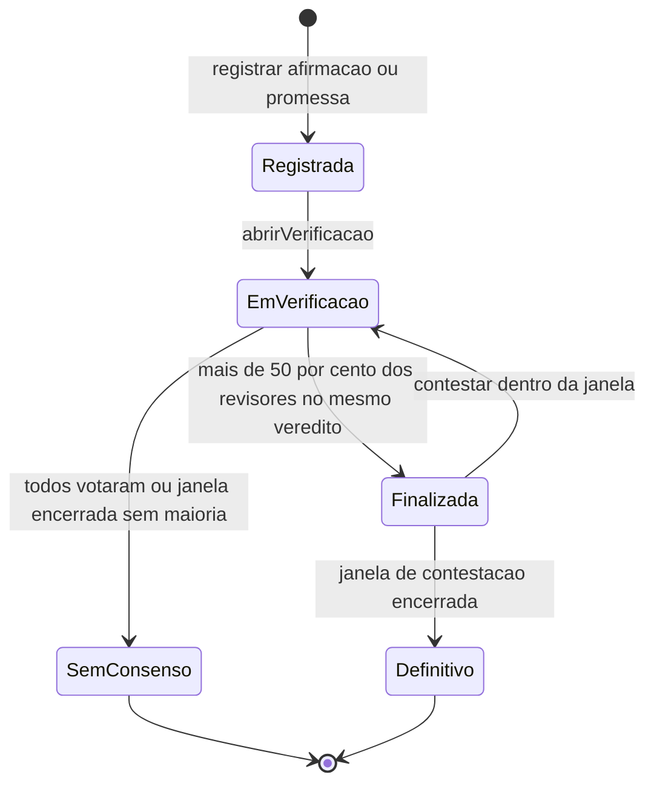
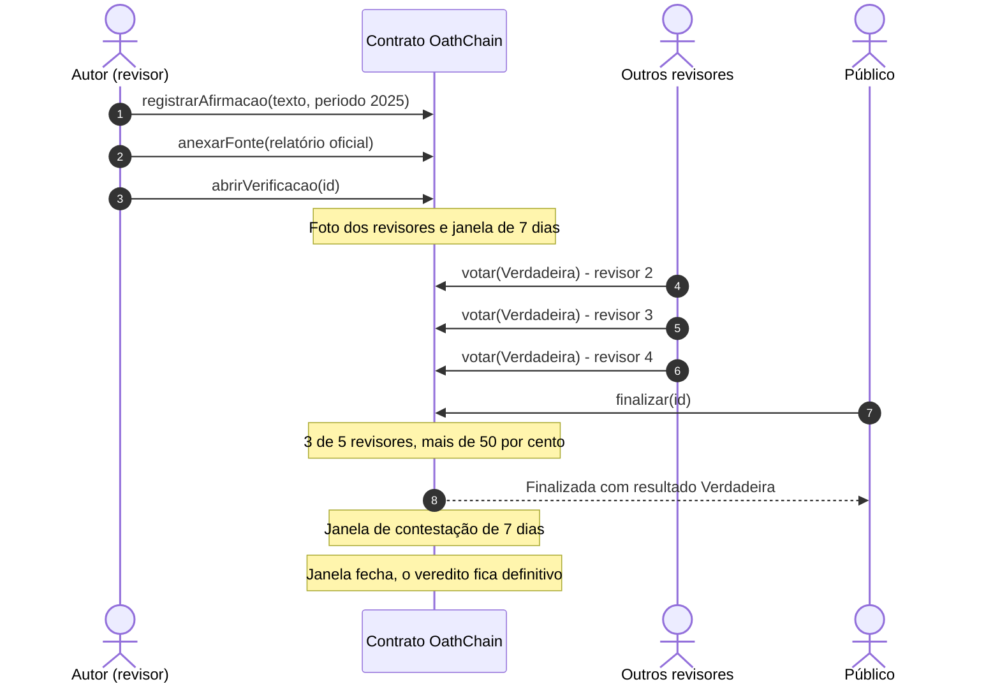
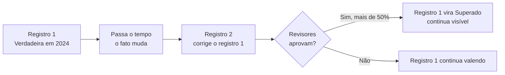
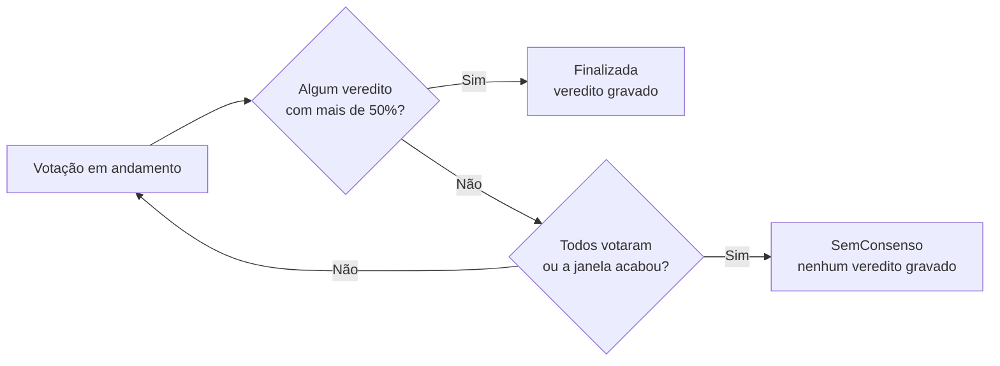
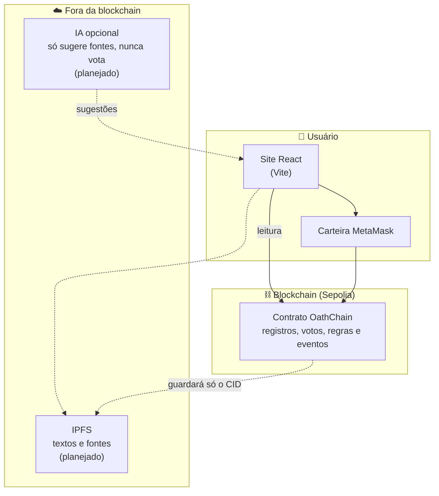

<div align="center">

<picture>
  <source media="(prefers-color-scheme: dark)" srcset="docs/logo-fundo-escuro.png">
  
</picture>

### Um livro-razão público para promessas e afirmações que ninguém consegue apagar

*Registre. Verifique. Cobre. Corrija sem apagar.*


-8247E5)


[Visão geral](#-visão-geral) •
[Como funciona](#-como-funciona) •
[A verdade muda com o tempo](#-a-verdade-muda-com-o-tempo) •
[Regras](#-as-regras-do-jogo) •
[O site](#-o-site) •
[Como rodar](#-como-rodar) •
[Roadmap](#-roadmap) •
[Limitações](#-limitações-e-riscos)

</div>

---

## 📖 Visão geral

**OathChain** (do inglês *oath*, "juramento") é um contrato inteligente, com um site em cima dele, que funciona como um **livro-razão público de afirmações e promessas verificadas**.

Qualquer pessoa pode **consultar**. Os **revisores** cadastrados registram, analisam as provas e votam. O resultado fica gravado na blockchain, com **data, autor e histórico completo de revisões**, sem que ninguém consiga apagar ou reescrever o passado.

- 🗣️ **Afirmação:** uma declaração sobre um fato, sempre ligada a um **período de referência** (por exemplo, "em 2025").
- 🤝 **Promessa:** um compromisso com **prazo** e **critérios mensuráveis** definidos no momento do registro.

> **Duas regras de ouro:**
> 1. Só existe veredito se **mais de 50% dos revisores** concordarem. Sem maioria, nenhum veredito é gravado.
> 2. Um veredito é uma **foto datada**, e não uma verdade eterna. Se o fato mudar, um **novo registro** o substitui, e o antigo continua visível como histórico.

Este projeto é a entrega do **bloco 5 do curso de blockchain da LetsCocreate**.

---

## 🎯 O problema

| # | Problema | Como o OathChain responde |
|---|----------|---------------------------|
| 1 | **Falta de memória pública confiável.** Anos depois, ninguém lembra exatamente o que foi prometido. | Cada registro tem data e autor gravados na blockchain. |
| 2 | **Verificações frágeis.** Vereditos podem ser editados ou sumir sem deixar rastro. | O histórico é imutável, e cada voto e cada rodada ficam registrados. |
| 3 | **Promessas vagas.** *"Vou melhorar a saúde"* nunca pode ser cobrado. | Toda promessa exige **prazo** e **critérios definidos no registro**. |
| 4 | **Veredito sem consenso.** Uma decisão apertada passa como se fosse certeza. | Sem mais de 50% dos revisores, nada é gravado como veredito. |
| 5 | **Verdades que mudam.** Um dado correto hoje pode estar errado amanhã. | O veredito é datado, e uma **correção posterior substitui** o registro antigo sem apagá-lo. |
| 6 | **Regras diferentes para pessoas diferentes.** | As mesmas regras, visíveis no contrato, valem para qualquer pessoa, partido ou tema. |

---

## ⛓️ Por que isso faz sentido na blockchain?

- ✅ **Registro imutável e com data:** prova que a afirmação existia em determinado momento e não foi reescrita depois. Um banco de dados comum pode ser alterado por quem o administra.
- ✅ **Partes que não confiam totalmente umas nas outras:** autores, revisores e público não dependem de um administrador central para guardar o histórico.
- ✅ **Regras transparentes:** maioria, janelas de tempo e limite de contestações ficam no código, visíveis e auditáveis.
- ✅ **Histórico completo:** cada voto, cada contestação e cada correção permanecem consultáveis.

> ⚠️ **O que a blockchain NÃO faz:** ela não garante que o dado inserido seja verdadeiro, apenas que ele não foi alterado depois. Quem confere as provas são os revisores. Veja [Limitações e riscos](#-limitações-e-riscos).

---

## 🔄 Como funciona

### Papéis

| Papel | O que faz |
|-------|-----------|
| 📝 **Autor** | Registra uma afirmação ou promessa, anexa fontes e pode contestar um veredito **uma única vez**. |
| 🧑‍⚖️ **Revisor** | Vota nos registros, com justificativa, e também anexa fontes durante a votação. Não vota no próprio registro. |
| 👀 **Público** | Consulta registros, votos, fontes e histórico, sem precisar de carteira. |
| 🔑 **Dono do contrato** | Cadastra e remove revisores e ajusta parâmetros (mínimo de revisores e janelas de tempo). |

### Ciclo de vida de um registro



| Estado | Significado |
|--------|-------------|
| `Registrada` | O registro existe e aceita fontes de qualquer pessoa. |
| `EmVerificacao` | A votação está aberta. Só revisores habilitados votam e anexam fontes. |
| `Finalizada` | Houve maioria. O veredito está gravado e ainda pode ser **contestado** durante a janela. |
| **Definitivo** | Não é um estado do contrato: é `ehDefinitivo(id) = true`, quando a janela de contestação fechou ou as 3 rodadas se esgotaram. |
| `SemConsenso` | Ninguém teve mais de 50%. **Nenhum veredito foi gravado.** Estado final. |

### Quem abre a verificação?

- **Promessa:** qualquer pessoa, **depois que o prazo vence**.
- **Afirmação:** somente o **autor**, quando as fontes já estiverem anexadas.
- Em ambos os casos é preciso ter pelo menos **3 revisores** cadastrados.

### Vereditos possíveis

| Tipo | Vereditos válidos |
|------|-------------------|
| 🗣️ Afirmação | `Verdadeira` · `Falsa` · `Inconclusiva` |
| 🤝 Promessa | `Cumprida` · `ParcialmenteCumprida` · `NaoCumprida` |

O contrato rejeita um veredito que não combine com o tipo (por exemplo, "Cumprida" numa afirmação).

### Exemplo passo a passo (fictício)



---

## 🕰️ A verdade muda com o tempo

Um veredito correto hoje pode ficar errado amanhã, e a blockchain não esquece. Por isso o OathChain trata o veredito como **"o que a comunidade concluiu, com as provas disponíveis, em uma data"**, e não como verdade eterna.

| Situação | Mecanismo |
|----------|-----------|
| Erro na votação, logo depois | **Contestação:** janela de 7 dias, no máximo 2 contestações por registro. |
| O fato mudou ou foi desmentido depois | **Registro que substitui** o antigo (campo "corrige o registro #N"). |

1. **Período de referência obrigatório.** "O Brasil paga R$ 1,2 tri em juros por ano" só faz sentido para um período. Ao exigir "em 2025", a maioria dos casos de "era verdade e deixou de ser" desaparece.
2. **O cartão mostra a data.** O site exibe "Verificado em [data]", e não um "Verdadeiro" solto.
3. **Correção por novo registro.** Uma nova afirmação pode apontar para uma afirmação **já finalizada** que ela corrige. Se a correção for aprovada como **Verdadeira**, o registro antigo ganha a faixa **"Superado pelo registro #N"** e continua visível, com todo o histórico.
4. **Correção reversível.** Se a correção for derrubada numa contestação, a superação é desfeita.



---

## ⚖️ As regras do jogo

### Regra da maioria

O veredito vence quando tem **mais de 50% dos revisores** que existiam **no momento em que a rodada abriu**. A conta usa o total de revisores, e não apenas os que votaram.

| Revisores na rodada | Votos iguais necessários |
|:-------------------:|:------------------------:|
| 3 | 2 |
| 4 | 3 |
| 5 | 3 |
| 7 | 4 |

Assim que um veredito alcança a maioria, **ele já não pode ser revertido** pelos votos restantes, e a finalização pode acontecer sem esperar os demais.

### Parâmetros do contrato

| Parâmetro | Valor inicial | Quem altera |
|-----------|:-------------:|-------------|
| `minRevisores` | 3 | Dono |
| `janelaVotacao` | 7 dias | Dono (vale só para rodadas futuras) |
| `janelaContestacao` | 7 dias | Dono (vale só para vereditos futuros) |
| `MAX_RODADAS` | 3 (constante) | Ninguém |

### Proteções embutidas

- 🔒 **Revisores "fotografados":** quem entra depois que a rodada abre **não vota nela**, e o total usado na maioria não muda no meio da votação.
- 🚫 **O autor não vota** no próprio registro, mesmo que seja revisor.
- 1️⃣ **O autor contesta uma única vez.**
- 🔁 **No máximo 3 rodadas por registro** (1 votação inicial + 2 contestações), para qualquer pessoa.
- ⏳ **Janela de votação** e **janela de contestação**, "fotografadas" no momento em que começam: mudar o parâmetro depois não afeta o que já está em andamento.
- 📎 **Fontes:** antes da verificação qualquer pessoa anexa; durante a verificação, só revisores habilitados; depois de encerrado, ninguém.
- 🗂️ **Histórico preservado:** votos e contagens ficam separados por rodada, e uma contestação nunca apaga a rodada anterior.
- 🧾 **Correção só de registro finalizado**, e só de afirmação por afirmação.

### O que acontece sem maioria?



> 💡 **Importante:** o registro original continua existindo na blockchain, porque ele foi gravado antes da votação e a rede não apaga nada. O que o contrato garante é que **nenhum veredito sem maioria seja gravado**. O site mostra como "verificado" somente o que `ehVerificado(id)` confirmar.

---

## 🖥️ O site

O site é uma aplicação **React (Vite)** que lê o contrato direto da blockchain, sem servidor próprio. Qualquer pessoa **lê** sem carteira; a carteira (MetaMask) só é pedida para agir.

| Tela | O que mostra |
|------|--------------|
| 🏠 **Início** | Página de apresentação, animada, para quem chega pela primeira vez: o problema, como funciona (registrar, votar, veredito, corrigir), números ao vivo do contrato, perguntas frequentes e atalhos para as outras telas. |
| 📚 **Estante** | Cada registro é um livro, com a cor da situação (em votação, em contestação, definitivo, superado, sem consenso). Filtros por situação e por ano, panorama e últimas atualizações. |
| 🔎 **Verificar** | Pesquisa se uma afirmação já foi verificada. Revisores veem o botão para registrar uma nova. |
| 📄 **Registro** | A página de um registro: veredito, votos, fontes, histórico de correções e as ações (abrir verificação, votar, finalizar, contestar, anexar fonte). |
| 🗺️ **Mapa** | Registros por estado e cidade, com a estante de cada região. |
| 🧑‍⚖️ **Revisores** | Painel de quem vota (votos dados, votos pendentes, % de acordo com a maioria) e a lista de revisores cadastrados. |
| 🕰️ **Linha do tempo** | Como a verdade mudou em cada assunto, com a cadeia de correções. |
| 🗂️ **Assuntos** | Uma sala para cada assunto: Educação, Economia, Saneamento, Saúde, Segurança e Meio Ambiente. |

Por enquanto, o **texto, o assunto, o estado e a cidade** de cada registro ficam guardados juntos, dentro do contrato (um pequeno JSON). Isso é **provisório**: com o IPFS, esse conteúdo passa para um arquivo lá, e o contrato guarda só o link (CID).

---

## 🎨 Identidade visual

O símbolo são **dois anéis entrelaçados**: um azul-marinho e um dourado, que lembram os elos de uma corrente (*chain*) e o "O" e o "C" do nome. O nome vai em minúsculas, em uma fonte sóbria e geométrica.

<p align="center">
  
  
</p>

| Cor | Código | Uso |
|-----|:------:|-----|
| Azul-marinho | `#041737` | Texto e anel da versão para fundo claro; fundo dos ícones |
| Dourado | `#daa14e` | Anel dourado, destaques e botões principais |
| Creme | `#f3ead3` | Texto e anel da versão para fundo escuro |

Os arquivos ficam em `docs/` (para o README e apresentações) e em `frontend/public/` (para o site: logo, símbolo, ícones da aba do navegador e imagem de compartilhamento).

---

## 🏗️ Arquitetura



**Por que dividir assim?** Guardar arquivos inteiros direto na blockchain seria caro demais. O plano é o contrato guardar só o **CID** (o "endereço" do conteúdo no IPFS) e o **hash**.

### Dados de cada registro

```text
Registro
├── id, autor, tipo (Afirmação | Promessa)
├── cidConteudo        -> conteúdo do registro (hoje um JSON; com o IPFS, o CID)
├── hashCriterios      -> hash dos critérios da promessa
├── prazo, criadoEm
├── estado, rodada, resultado
├── "foto" da rodada: totalRevisores, epocaAbertura, fimVotacao
├── veredito datado: finalizadoEm, fimContestacao
└── afirmações: referencia (período), substitui, superadaPor

Fonte
└── cid, hashConteudo, anexadaPor, data, rodada
```

### Funções principais

| Função | Quem usa | O que faz |
|--------|----------|-----------|
| `registrarAfirmacao(conteudo, referencia, substituiId)` | Qualquer carteira* | Cria uma afirmação, com período obrigatório e, se quiser, o id do registro que ela corrige. |
| `registrarPromessa(conteudo, hashCriterios, prazo)` | Qualquer carteira* | Cria uma promessa com prazo no futuro e critérios obrigatórios. |
| `anexarFonte(id, cid, hash)` | Qualquer pessoa ou revisor | Anexa uma fonte ao registro. |
| `abrirVerificacao(id)` | Público (promessa) ou autor (afirmação) | Abre a votação e tira a "foto" dos revisores. |
| `votar(id, veredito, justificativa)` | Revisor habilitado | Registra um voto por rodada. |
| `finalizar(id)` | Qualquer pessoa | Fecha a rodada: `Finalizada` ou `SemConsenso`. Aplica a substituição, se houver. |
| `contestar(id, motivo)` | Autor (1 vez) ou revisor | Abre uma nova rodada, dentro da janela e do limite de 3. |
| `definirRevisor`, `definirMinRevisores`, `definirJanelaVotacao`, `definirJanelaContestacao` | Dono | Ajustam revisores e parâmetros. |

\* O **site** só mostra o botão de registrar para revisores (`SO_REVISOR_REGISTRA` em `frontend/src/config.js`), mas o contrato ainda aceita registro de qualquer carteira. Veja [Limitações](#-limitações-e-riscos).

**Consultas (gratuitas):** `obterRegistro` · `ehVerificado` · `ehDefinitivo` · `obterFontes` · `obterVoto` · `obterContagem` · `obterRevisores` · `revisorDesde`

### Eventos (o "diário" público)

`RegistroCriado` · `FonteAnexada` · `VerificacaoAberta` · `VotoRegistrado` · `Finalizado` · `SemConsenso` · `Superada` · `SuperacaoRevertida` · `Contestado` · `RevisorAlterado`

---

## 🛠️ Tecnologias

| Camada | Ferramenta |
|--------|------------|
| Contrato inteligente | [Solidity](https://soliditylang.org/) 0.8.24 |
| Ambiente de desenvolvimento e testes | [Hardhat](https://hardhat.org/) 2 |
| Biblioteca de segurança | [OpenZeppelin Contracts](https://www.openzeppelin.com/contracts) 5 (`Ownable`) |
| Testes | Mocha, Chai e ethers.js 6 |
| Site | [React](https://react.dev/) com [Vite](https://vitejs.dev/) e ethers.js 6 |
| Carteira | MetaMask |
| Rede de testes | Sepolia, com um provedor RPC (Alchemy) |
| Armazenamento (planejado) | IPFS com serviço de *pinning* |

---

## 📁 Estrutura do projeto

```text
OathChain/
├── contracts/
│   └── OathChain.sol            # contrato principal
├── test/
│   └── OathChain.test.js        # 41 testes automatizados
├── scripts/
│   ├── deploy.js                # publica o contrato e grava o endereço
│   ├── setup-revisores.js       # cadastra os revisores no contrato
│   └── janelas.js               # ajusta as janelas (útil na demonstração)
├── deployments/
│   └── sepolia.json             # endereço do contrato publicado (público)
├── docs/                        # logo e imagens de apresentação
├── frontend/
│   ├── index.html               # título, ícones e imagem de compartilhamento
│   ├── public/                  # logo, símbolo e ícones do site
│   └── src/
│       ├── App.jsx, main.jsx    # raiz do site e navegação
│       ├── paginas/             # Início, Estante, Verificar, Registro, Mapa, Revisores, Linha, Assuntos
│       ├── useDados.js          # carteira, rede e leitura do contrato
│       ├── oathchain.js         # leitura e envio de dados do contrato
│       ├── config.js            # rede, regra de quem registra
│       ├── deployment.json      # endereço do contrato (o deploy atualiza sozinho)
│       └── abi.json             # descrição do contrato
├── hardhat.config.js
├── package.json
└── README.md
```

---

## 🚀 Como rodar

### Pré-requisitos

- [Node.js](https://nodejs.org/) (versão LTS) e [Git](https://git-scm.com/)
- Um editor, como o [VS Code](https://code.visualstudio.com/)
- Para publicar na Sepolia: a extensão **MetaMask**, uma carteira de testes com ETH de teste e uma chave RPC (por exemplo, no Alchemy)

### 1. Contrato

```bash
git clone https://github.com/paivafgustavo/OathChain.git
cd OathChain
npm install
npx hardhat compile
npx hardhat test
```

Resultado esperado:

```text
  41 passing
```

### 2. Publicar na Sepolia

Crie um arquivo `.env` na raiz (ele já está no `.gitignore` e **nunca** deve ir para o GitHub):

```text
SEPOLIA_RPC_URL=https://eth-sepolia.g.alchemy.com/v2/SUA_CHAVE
PRIVATE_KEY=chave_privada_da_carteira_de_testes
```

```bash
npx hardhat run scripts/deploy.js --network sepolia
npx hardhat run scripts/setup-revisores.js --network sepolia
```

O `deploy.js` grava o endereço em `deployments/sepolia.json` e em `frontend/src/deployment.json`, e o site passa a usar o contrato novo sozinho. Edite a lista de carteiras no topo de `scripts/setup-revisores.js` para cadastrar os seus revisores.

> ⚠️ Use **só uma carteira de testes**, sem dinheiro de verdade. Nunca compartilhe a chave privada nem a frase de 12 palavras.

### 3. Site

```bash
cd frontend
npm install
npm run dev
```

Abra o endereço que aparecer (normalmente `http://localhost:5173`). Para votar e registrar, conecte a MetaMask na rede **Sepolia** e use contas de revisor.

### Demonstração com janelas curtas

Na Sepolia o tempo não pode ser acelerado. Para mostrar uma janela fechando ao vivo, edite os valores (em segundos) no topo de `scripts/janelas.js`, por exemplo 600 para votação e 300 para contestação, e rode:

```bash
npx hardhat run scripts/janelas.js --network sepolia
```

Depois volte aos valores normais (604800 = 7 dias). Os testes automatizados, por outro lado, simulam a passagem do tempo com os recursos do Hardhat.

---

## 🧪 Cobertura dos testes

Os **41 testes** simulam também a **passagem do tempo** (promessa vencendo, janelas fechando).

| Área | O que é verificado |
|------|--------------------|
| **Registro** | Afirmação e promessa; prazo no passado; critérios vazios; CID vazio; período de referência obrigatório. |
| **Administração** | Só o dono mexe em revisores e parâmetros; contagem sem duplicar; mínimo de revisores; lista de revisores sem repetição. |
| **Fontes** | Quem pode anexar em cada estado; registro da rodada. |
| **Regra da maioria** | 2 de 3 bastam; 1 voto não é maioria; 1-1-1 vira `SemConsenso`; janela acabando; 4 revisores exigem 3 votos. |
| **Quem pode votar** | Não-revisor, voto duplicado, veredito inválido, autor votando, revisor que entra depois, revisor removido. |
| **Contestação** | Autor só 1 vez; limite de 3 rodadas; histórico preservado; nova rodada com nova "foto". |
| **Janela de contestação** | Fecha depois de 7 dias; torna o veredito definitivo; janela "fotografada"; limite de rodadas também torna definitivo. |
| **Substituição** | Só substitui afirmação finalizada; correção aprovada supera o antigo; rejeitada ou sem consenso não supera; correção derrubada desfaz a superação. |

---

## 🗺️ Roadmap

**Semana 1: contrato** ✅

- [x] Estruturas, funções e eventos
- [x] Regra de maioria, contestação e limite de rodadas
- [x] Testes automatizados
- [x] Código e README no GitHub

**Semana 2: publicação e interface** 🚧

- [x] Publicar o contrato na testnet **Sepolia**
- [x] Cadastrar revisores de teste
- [x] Janela de contestação e veredito definitivo
- [x] Correção por novo registro ("Superado") e período de referência
- [x] Site em React ligado ao contrato (estante, mapa, revisores, linha do tempo, assuntos)
- [x] Identidade visual (logo) e página inicial animada para quem chega pela primeira vez
- [x] Fluxo completo testado com a MetaMask: registrar, votar, finalizar, contestar, corrigir
- [ ] Integrar o **IPFS** (texto, metadados e fontes)
- [ ] Reputação simples dos revisores
- [ ] (Opcional) script de IA para sugerir fontes

**Semana 3: demonstração e relatório** 📝

- [ ] Demonstração com a passagem do tempo (rede local)
- [ ] Polimento do site e vídeo
- [ ] Relatório com governança e limitações

### 🔭 Visão de futuro

- 🌐 **API aberta:** sites, aplicativos e extensões de navegador consultam os vereditos.
- 📺 **Verificador em tempo real:** um aplicativo em cima do registro, que consulta vereditos já existentes.
- 📚 **Arquivo permanente de fontes:** cada fonte citada é copiada e guardada de forma imutável, para o link não morrer.
- ⚡ **Rede de camada 2:** reduz o custo por registro.
- 🏛️ **Governança comunitária:** regras de revisão e reputação decididas de forma aberta.

---

## ⚠️ Limitações e riscos

Este é um **protótipo acadêmico**. Os limites abaixo são conhecidos e fazem parte do projeto.

| Risco | Descrição | Resposta atual ou prevista |
|-------|-----------|----------------------------|
| **Dado falso na entrada** | A blockchain garante que o registro não foi alterado, não que seja verdadeiro. | Provas anexadas e revisadas por pessoas. |
| **Quem decide o que é verdade** | O ponto central do projeto. | Critérios mensuráveis, vários revisores, maioria obrigatória, contestação e correção. |
| **Verdade que muda** | Um veredito correto hoje pode estar errado depois. | Veredito datado, período de referência e registro que substitui o antigo. |
| **Contas falsas (ataque sybil)** | Muitas contas votando em massa. | Lista fixa de revisores no protótipo; reputação e depósito em garantia previstos. |
| **Poder do dono** | O dono escolhe os revisores e ajusta os parâmetros. | Limitação assumida; governança comunitária fica para o futuro. |
| **Registro aberto no contrato** | O site só mostra o botão de registrar para revisores, mas o contrato aceita registro de qualquer carteira. | Decisão em aberto: exigir ser revisor também no contrato. |
| **Conteúdo dentro do contrato** | Por enquanto o texto e os metadados ficam gravados no próprio contrato. | O IPFS vai guardar o conteúdo, e o contrato só o link. |
| **Hash da fonte não conferido** | O contrato não verifica se o hash corresponde ao arquivo. | A conferência é feita por quem abre a cópia. |
| **Conteúdo que ninguém apaga** | Um registro imutável também pode receber conteúdo ilegal ou nocivo. | Discussão obrigatória no relatório. |
| **Difamação e questões legais** | Emitir veredito sobre pessoas reais é sensível. | Na demonstração, só afirmações fictícias ou documentadas publicamente. |
| **Contestação por revisores** | Um revisor pode contestar dentro da janela e do limite de rodadas. | Janela de tempo e limite global de 3 rodadas. |
| **Público não contesta direto** | Só o autor e os revisores contestam. | Quem discorda pede a um revisor ou registra uma correção. |
| **Disponibilidade do IPFS** | Os arquivos precisam continuar sendo mantidos por alguém. | Serviço de *pinning*. |

> 🔎 **Neutralidade:** as regras do contrato são idênticas para qualquer pessoa, partido ou tema. Nenhum nome, lado político ou assunto recebe tratamento diferente no código.

---

## 📜 Aviso

OathChain é um **projeto educacional** e roda apenas em ambiente de testes. Os exemplos usados são **fictícios**. Não use este contrato para emitir vereditos sobre pessoas reais, e não envie dinheiro de verdade para ele.

---

## 👤 Autor

**Gustavo** · Ciência da Computação, UFG
Projeto do curso de blockchain da **LetsCocreate** (bloco 5)

GitHub: [@paivafgustavo](https://github.com/paivafgustavo)

---

## 📄 Licença

Distribuído sob a licença **MIT**.

<div align="center">

*Promessas feitas em público merecem memória pública.*

</div>
