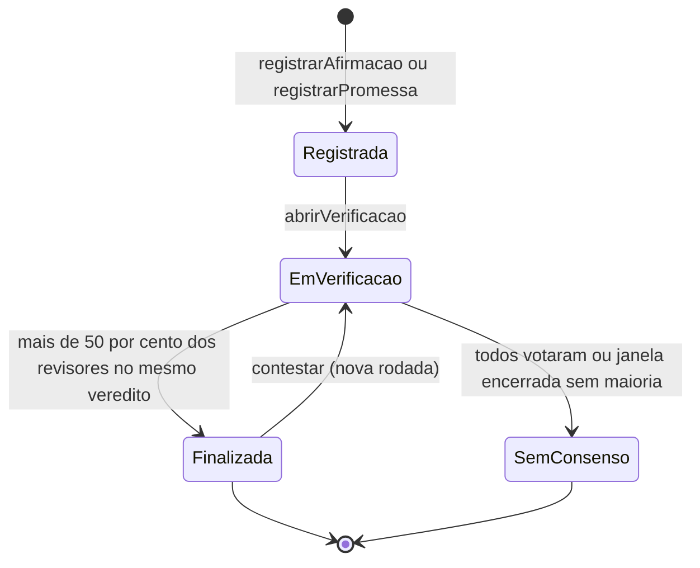
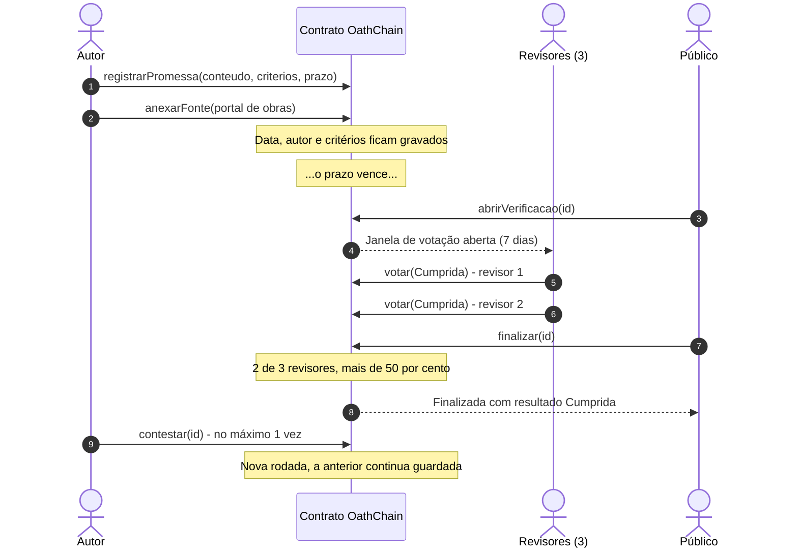
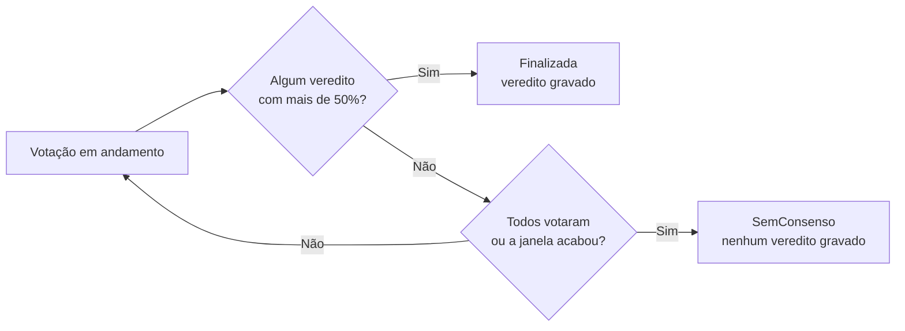
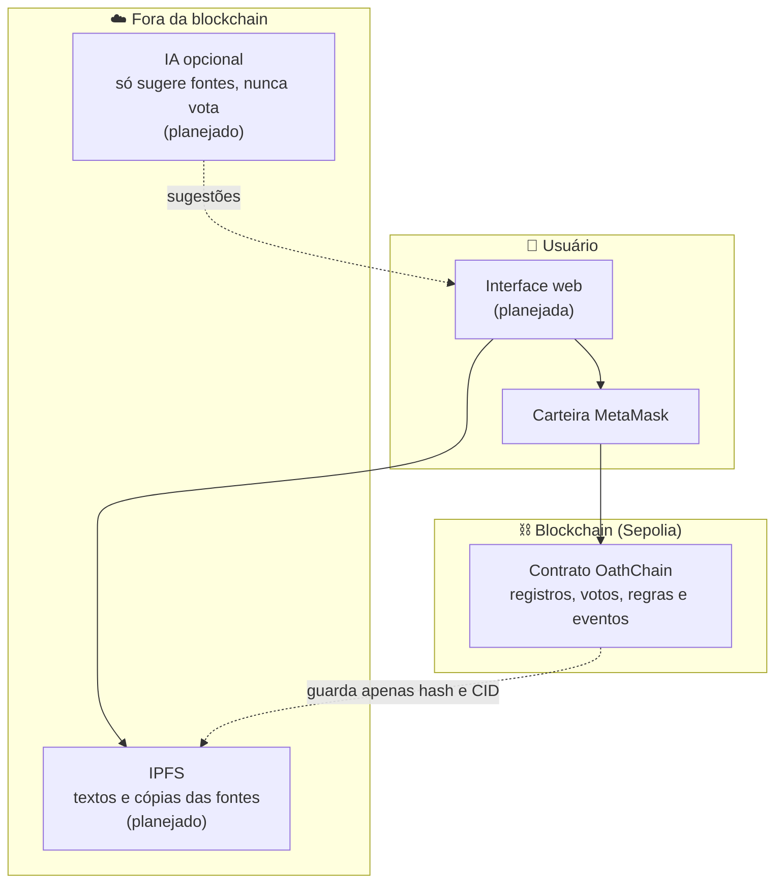

<div align="center">

# ⛓️ OathChain

### Um livro-razão público para promessas e afirmações que ninguém consegue apagar

*Registre. Verifique. Cobre.*


[Visão geral](#-visão-geral) •
[Como funciona](#-como-funciona) •
[Regras](#-as-regras-do-jogo) •
[Arquitetura](#-arquitetura) •
[Como rodar](#-como-rodar) •
[Roadmap](#-roadmap) •
[Limitações](#-limitações-e-riscos)

</div>

---

## 📖 Visão geral

**OathChain** (do inglês *oath*, "juramento") é um contrato inteligente que funciona como um **livro-razão público de afirmações e promessas verificadas**.

Qualquer pessoa pode registrar:

- 🗣️ uma **afirmação**: por exemplo, uma declaração feita por uma figura pública;
- 🤝 uma **promessa**: por exemplo, *"vou entregar 10 escolas até 31/12/2027"*.

Uma comunidade de **revisores** analisa as provas e vota. O resultado fica gravado na blockchain, com **data, autor e histórico completo de revisões**, sem que ninguém consiga apagar ou reescrever o passado.

> **A regra de ouro do projeto:** só existe veredito se **mais de 50% dos revisores** concordarem. Sem maioria, nenhum veredito é gravado.

Este projeto é a entrega do **bloco 5 do curso de blockchain da LetsCocreate**.

---

## 🎯 O problema

| # | Problema | Como o OathChain responde |
|---|----------|---------------------------|
| 1 | **Falta de memória pública confiável.** Anos depois, ninguém lembra exatamente o que foi prometido. | Cada registro tem data e autor gravados na blockchain. |
| 2 | **Verificações frágeis.** Vereditos podem ser editados ou sumir sem deixar rastro. | O histórico é imutável e cada voto fica registrado em eventos. |
| 3 | **Promessas vagas.** *"Vou melhorar a saúde"* nunca pode ser cobrado. | Toda promessa exige **prazo** e **critérios definidos no momento do registro**. |
| 4 | **Regras diferentes para pessoas diferentes.** | As mesmas regras, visíveis no contrato, valem para qualquer pessoa, partido ou tema. |
| 5 | **Veredito sem consenso.** Uma decisão apertada passa como se fosse certeza. | Sem mais de 50% dos revisores, nada é gravado como veredito. |

---

## ⛓️ Por que isso faz sentido na blockchain?

- ✅ **Registro imutável e com data:** prova que a promessa existia em determinado momento e não foi reescrita depois. Um banco de dados comum pode ser alterado por quem o administra.
- ✅ **Partes que não confiam totalmente umas nas outras:** autores, revisores e público não dependem de um administrador central para guardar o histórico.
- ✅ **Regras transparentes:** quórum, janela de votação e limite de contestações ficam no código, visíveis e auditáveis.
- ✅ **Histórico completo:** cada voto e cada rodada de contestação permanecem consultáveis.

> ⚠️ **O que a blockchain NÃO faz:** ela não garante que o dado inserido seja verdadeiro, apenas que ele não foi alterado depois. Quem confere as provas são os revisores. Veja a seção [Limitações e riscos](#-limitações-e-riscos).

---

## 🔄 Como funciona

### Papéis

| Papel | O que faz |
|-------|-----------|
| 📝 **Autor** | Registra uma afirmação ou promessa, anexa fontes e pode contestar um veredito **uma única vez**. |
| 🧑‍⚖️ **Revisor** | Vota nos registros, com justificativa. É escolhido pelo dono do contrato (lista inicial). |
| 👀 **Público** | Consulta registros, votos, fontes e histórico. Qualquer pessoa pode ler. |
| 🔑 **Dono do contrato** | Cadastra e remove revisores e ajusta parâmetros (mínimo de revisores e janela de votação). |

### Ciclo de vida de um registro



| Estado | Significado |
|--------|-------------|
| `Registrada` | O registro existe e aceita fontes de qualquer pessoa. |
| `EmVerificacao` | A votação está aberta. Só revisores habilitados votam e anexam fontes. |
| `Finalizada` | Houve maioria. O veredito está gravado e `ehVerificado(id)` retorna `true`. |
| `SemConsenso` | Ninguém teve mais de 50%. **Nenhum veredito foi gravado.** Estado definitivo. |

### Quem abre a verificação?

- **Promessa:** qualquer pessoa, **depois que o prazo vence**.
- **Afirmação:** somente o **autor**, quando as fontes já estiverem anexadas.
- Em ambos os casos é preciso ter pelo menos **3 revisores** cadastrados.

### Veredito possível

| Tipo | Vereditos válidos |
|------|-------------------|
| 🗣️ Afirmação | `Verdadeira` · `Falsa` · `Inconclusiva` |
| 🤝 Promessa | `Cumprida` · `ParcialmenteCumprida` · `NaoCumprida` |

O contrato rejeita um veredito que não combine com o tipo (por exemplo, "Cumprida" numa afirmação).

### Exemplo passo a passo (fictício)



---

## ⚖️ As regras do jogo

### Regra da maioria

O veredito vence quando tem **mais de 50% dos revisores** que existiam **no momento em que a rodada abriu**. A conta usa o total de revisores, e não apenas os que votaram.

| Revisores na rodada | Votos iguais necessários |
|:-------------------:|:------------------------:|
| 3 | 2 |
| 4 | 3 |
| 5 | 3 |
| 7 | 4 |

Isso significa que, assim que um veredito alcança a maioria, **ele já não pode ser revertido** pelos votos restantes e a finalização pode acontecer sem esperar os demais.

### Parâmetros do contrato

| Parâmetro | Valor inicial | Quem altera |
|-----------|:-------------:|-------------|
| `minRevisores` | 3 | Dono |
| `janelaVotacao` | 7 dias | Dono (vale só para rodadas futuras) |
| `MAX_RODADAS` | 3 (constante) | Ninguém |

### Proteções embutidas

- 🔒 **Revisores "fotografados":** quem entra depois que a rodada abre **não vota nela**, e o total usado na maioria não muda no meio da votação.
- 🚫 **O autor não vota** no próprio registro, mesmo que seja revisor.
- 1️⃣ **O autor contesta uma única vez.**
- 🔁 **No máximo 3 rodadas por registro** (1 votação inicial + 2 contestações), para qualquer pessoa.
- ⏳ **Janela de votação:** passado o prazo, não se vota mais.
- 📎 **Fontes:** antes da verificação qualquer pessoa anexa; durante a verificação, só revisores habilitados; depois de encerrado, ninguém.
- 🗂️ **Histórico preservado:** votos e contagens ficam separados por rodada, e uma contestação nunca apaga a rodada anterior.

### O que acontece sem maioria?



> 💡 **Importante:** o registro original continua existindo na blockchain, porque ele foi gravado antes da votação e a rede não apaga nada. O que o contrato garante é que **nenhum veredito sem maioria seja gravado**. A interface deve mostrar como "verificado" somente o que `ehVerificado(id)` confirmar.

---

## 🏗️ Arquitetura



**Por que dividir assim?** Guardar arquivos inteiros direto na blockchain seria caro demais. O contrato guarda só o **CID** (o "endereço" do conteúdo no IPFS) e o **hash**. Qualquer pessoa pode abrir a cópia e conferir se o hash bate com o registrado.

### Dados de cada registro

```text
Registro
├── id, autor, tipo (Afirmação | Promessa)
├── cidConteudo        -> link do texto no IPFS
├── hashCriterios      -> hash dos critérios da promessa
├── prazo, criadoEm
├── estado, rodada, resultado
└── "foto" da rodada: totalRevisores, epocaAbertura, fimVotacao

Fonte
└── cid, hashConteudo, anexadaPor, data, rodada
```

### Funções principais

| Função | Quem usa | O que faz |
|--------|----------|-----------|
| `registrarAfirmacao(cid)` | Qualquer pessoa | Cria uma afirmação. |
| `registrarPromessa(cid, hashCriterios, prazo)` | Qualquer pessoa | Cria uma promessa com prazo no futuro e critérios obrigatórios. |
| `anexarFonte(id, cid, hash)` | Qualquer pessoa ou revisor | Anexa uma fonte arquivada ao registro. |
| `abrirVerificacao(id)` | Público (promessa) ou autor (afirmação) | Abre a votação e tira a "foto" dos revisores. |
| `votar(id, veredito, cidJustificativa)` | Revisor habilitado | Registra um voto por rodada. |
| `finalizar(id)` | Qualquer pessoa | Fecha a rodada: `Finalizada` ou `SemConsenso`. |
| `contestar(id, cidMotivo)` | Autor (1 vez) ou revisor | Abre uma nova rodada, respeitando o limite de 3. |
| `definirRevisor(endereco, ativo)` | Dono | Adiciona ou remove um revisor. |
| `definirMinRevisores(n)` | Dono | Ajusta o mínimo de revisores. |
| `definirJanelaVotacao(segundos)` | Dono | Ajusta a duração da votação. |

**Consultas (gratuitas):** `obterRegistro` · `ehVerificado` · `obterFontes` · `obterVoto` · `obterContagem`

### Eventos (o "diário" público)

`RegistroCriado` · `FonteAnexada` · `VerificacaoAberta` · `VotoRegistrado` · `Finalizado` · `SemConsenso` · `Contestado` · `RevisorAlterado`

---

## 🛠️ Tecnologias

| Camada | Ferramenta |
|--------|------------|
| Contrato inteligente | [Solidity](https://soliditylang.org/) 0.8.24 |
| Ambiente de desenvolvimento e testes | [Hardhat](https://hardhat.org/) 2 |
| Biblioteca de segurança | [OpenZeppelin Contracts](https://www.openzeppelin.com/contracts) 5 (`Ownable`) |
| Testes | Mocha, Chai e ethers.js 6 |
| Rede de testes (planejada) | Sepolia |
| Armazenamento (planejado) | IPFS com serviço de *pinning* |
| Interface (planejada) | React e ethers.js |

---

## 📁 Estrutura do projeto

```text
OathChain/
├── contracts/
│   └── OathChain.sol        # contrato principal
├── test/
│   └── OathChain.test.js    # 26 testes automatizados
├── hardhat.config.js        # configuração do Hardhat
├── package.json
└── README.md
```

---

## 🚀 Como rodar

### Pré-requisitos

- [Node.js](https://nodejs.org/) (versão LTS)
- [Git](https://git-scm.com/)
- Um editor, como o [VS Code](https://code.visualstudio.com/) com a extensão *Solidity* da Nomic Foundation

### Instalação

```bash
git clone https://github.com/paivafgustavo/OathChain.git
cd OathChain
npm install
```

Se preferir montar o ambiente do zero, estas são as versões usadas:

```bash
npm install --save-dev hardhat@2 @nomicfoundation/hardhat-toolbox@5 @openzeppelin/contracts@5
```

### Compilar

```bash
npx hardhat compile
```

### Testar

```bash
npx hardhat test
```

Resultado esperado:

```text
  26 passing
```

---

## 🧪 Cobertura dos testes

Os 26 testes simulam também a **passagem do tempo** (promessa vencendo, janela de votação fechando), usando os recursos de manipulação de tempo do Hardhat.

| Área | O que é verificado |
|------|--------------------|
| **Registro** | Afirmação e promessa; prazo no passado; critérios vazios; CID vazio. |
| **Administração** | Só o dono mexe em revisores e parâmetros; contagem sem duplicar; mínimo de revisores. |
| **Fontes** | Quem pode anexar em cada estado; registro da rodada. |
| **Regra da maioria** | 2 de 3 bastam; 1 voto não é maioria; 1-1-1 vira `SemConsenso`; janela acabando; 4 revisores exigem 3 votos. |
| **Quem pode votar** | Não-revisor, voto duplicado, veredito inválido, autor votando, revisor que entra depois, revisor removido. |
| **Contestação** | Autor só 1 vez; limite de 3 rodadas; histórico preservado; nova rodada com nova "foto" de revisores; `SemConsenso` definitivo. |

---

## 🗺️ Roadmap

**Semana 1: contrato** ✅

- [x] Estruturas, funções e eventos
- [x] Regra de maioria, contestação e limite de rodadas
- [x] 26 testes automatizados
- [x] Código publicado no GitHub

**Semana 2: publicação e interface** 🚧

- [ ] Publicar o contrato na testnet **Sepolia**
- [ ] Integrar o armazenamento no **IPFS**
- [ ] Reputação simples dos revisores
- [ ] Interface web com React e ethers.js
- [ ] (Opcional) script de IA para sugerir fontes

**Semana 3: demonstração e relatório** 📝

- [ ] Demonstração com a passagem do tempo simulada
- [ ] Polimento da interface e vídeo
- [ ] Relatório com governança e limitações

### 🔭 Visão de futuro

- 🌐 **API aberta:** sites, aplicativos e extensões de navegador consultam os vereditos.
- 📺 **Verificador em tempo real:** um aplicativo em cima do registro, que consulta vereditos já existentes.
- 📚 **Arquivo permanente de fontes:** cada fonte citada é copiada e guardada de forma imutável, para o link não morrer. Pode crescer até uma biblioteca aberta de conhecimento.
- ⚡ **Rede de camada 2:** reduz o custo por registro.
- 🏛️ **Governança comunitária:** regras de revisão e reputação decididas de forma aberta.

---

## ⚠️ Limitações e riscos

Este é um **protótipo acadêmico**. Os limites abaixo são conhecidos e fazem parte do projeto.

| Risco | Descrição | Resposta atual ou prevista |
|-------|-----------|----------------------------|
| **Dado falso na entrada** | A blockchain garante que o registro não foi alterado, não que seja verdadeiro. | Provas arquivadas e revisadas por pessoas. |
| **Quem decide o que é verdade** | O ponto central do projeto. | Critérios mensuráveis, mais de um revisor, maioria obrigatória e contestação. |
| **Contas falsas (ataque sybil)** | Muitas contas votando em massa. | Lista fixa de revisores no MVP; reputação e depósito em garantia previstos. |
| **Poder do dono** | O dono escolhe os revisores. | Limitação assumida no MVP; governança comunitária fica para o futuro. |
| **Hash da fonte não conferido** | O contrato não verifica se o hash corresponde ao arquivo. | A conferência é feita por quem abre a cópia no IPFS. |
| **Conteúdo que ninguém apaga** | Um registro imutável também pode receber conteúdo ilegal ou nocivo. | Discussão obrigatória no relatório. |
| **Difamação e questões legais** | Emitir veredito sobre pessoas reais é sensível. | Na demonstração, só promessas fictícias ou documentadas publicamente. |
| **Contestação por revisores** | Um revisor pode contestar dentro do limite de 3 rodadas. | Limite global de rodadas. |
| **Disponibilidade do IPFS** | Os arquivos precisam continuar sendo mantidos por alguém. | Serviço de *pinning*. |

> 🔎 **Neutralidade:** as regras do contrato são idênticas para qualquer pessoa, partido ou tema. Nenhum nome, lado político ou assunto recebe tratamento diferente no código.

---

## 📜 Aviso

OathChain é um **projeto educacional** e roda apenas em ambiente de testes. Os exemplos usados são **fictícios**. Não use este contrato para emitir vereditos sobre pessoas reais, e não envie dinheiro de verdade para ele.

---

## 👤 Autor

**Gustavo** · Ciência da Computação, UFG
Projeto do curso de blockchain da **LetsCocreate** (bloco 5)

GitHub: [@paivafgustavo](https://github.com/paivafgustavo)

---

## 📄 Licença

Distribuído sob a licença **MIT**.

<div align="center">

*Promessas feitas em público merecem memória pública.*

</div>
