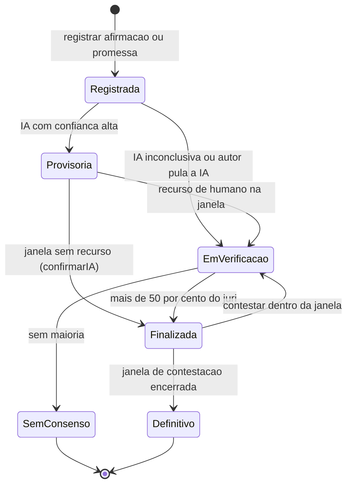
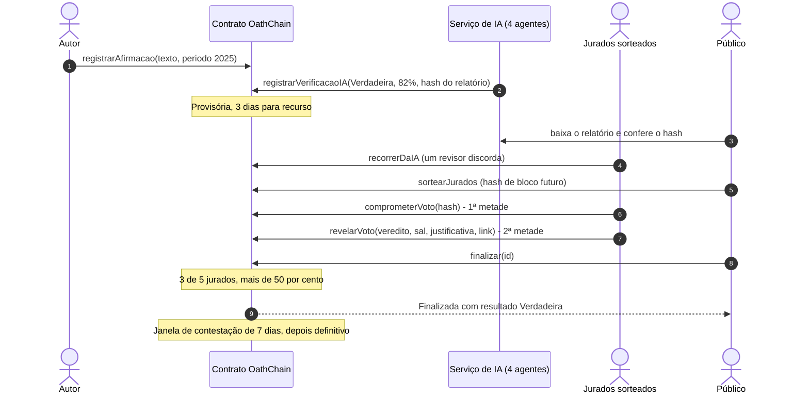
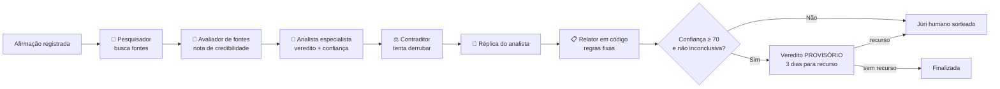
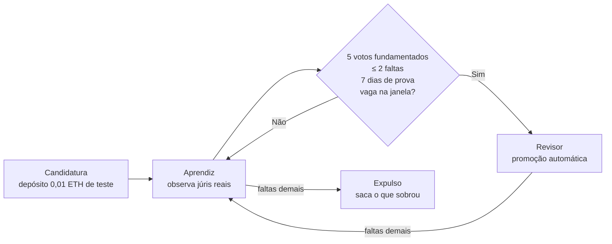
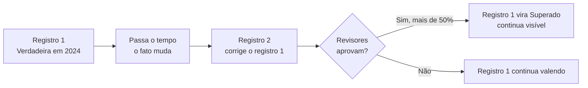
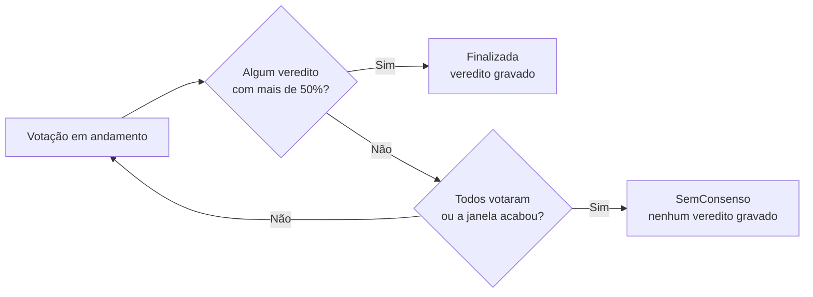
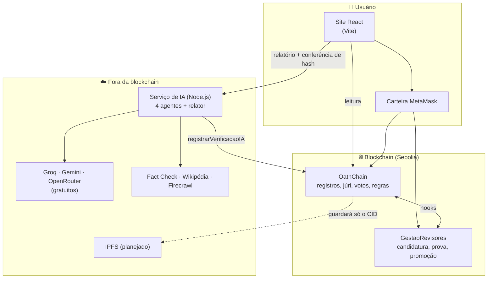

<div align="center">

<picture>
  <source media="(prefers-color-scheme: dark)" srcset="docs/logo-fundo-escuro.png">
  
</picture>

### Um livro-razão público para promessas e afirmações que ninguém consegue apagar

*Registre. Verifique. Cobre. Corrija sem apagar.*


-8247E5)


[Visão geral](#-visão-geral) •
[Como funciona](#-como-funciona) •
[Verificação híbrida](#-verificação-híbrida-ia--júri) •
[Revisores sem porteiro](#-revisores-sem-porteiro-candidatura-e-prova) •
[A verdade muda com o tempo](#-a-verdade-muda-com-o-tempo) •
[Regras](#-as-regras-do-jogo) •
[O site](#-o-site) •
[Como rodar](#-como-rodar) •
[Roadmap](#-roadmap) •
[Ameaças](#-modelo-de-ameaças) •
[Limitações](#-limitações-e-riscos)

</div>

---

## 📖 Visão geral

**OathChain** (do inglês *oath*, "juramento") é um contrato inteligente, com um site em cima dele, que funciona como um **livro-razão público de afirmações e promessas verificadas**.

Qualquer pessoa pode **consultar**. A verificação é **híbrida**: quatro **agentes de IA** (100% gratuitos) pesquisam as fontes e dão um veredito **provisório** em minutos; **humanos** só entram para recorrer, em um **júri sorteado** com **voto secreto**. O resultado fica gravado na blockchain, com **data, autor, relatório da IA e histórico completo**, sem que ninguém consiga apagar ou reescrever o passado.

- 🗣️ **Afirmação:** uma declaração sobre um fato, sempre ligada a um **período de referência** (por exemplo, "em 2025").
- 🤝 **Promessa:** um compromisso com **prazo** e **critérios mensuráveis** definidos no momento do registro.

> **Duas regras de ouro:**
> 1. Só existe veredito se a **IA tiver confiança alta e ninguém recorrer**, ou se **mais de 50% do júri** concordar. Sem isso, nenhum veredito é gravado.
> 2. Um veredito é uma **foto datada**, e não uma verdade eterna. Se o fato mudar, um **novo registro** o substitui, e o antigo continua visível como histórico.

Este projeto é a entrega do **bloco 5 do curso de blockchain da LetsCocreate**.

---

## 🎯 O problema

| # | Problema | Como o OathChain responde |
|---|----------|---------------------------|
| 1 | **Falta de memória pública confiável.** Anos depois, ninguém lembra exatamente o que foi prometido. | Cada registro tem data e autor gravados na blockchain. |
| 2 | **Verificações frágeis.** Vereditos podem ser editados ou sumir sem deixar rastro. | O histórico é imutável, e cada voto e cada rodada ficam registrados. |
| 3 | **Promessas vagas.** *"Vou melhorar a saúde"* nunca pode ser cobrado. | Toda promessa exige **prazo** e **critérios definidos no registro**. |
| 4 | **Veredito sem consenso.** Uma decisão apertada passa como se fosse certeza. | Sem mais de 50% dos revisores, nada é gravado como veredito. |
| 5 | **Verdades que mudam.** Um dado correto hoje pode estar errado amanhã. | O veredito é datado, e uma **correção posterior substitui** o registro antigo sem apagá-lo. |
| 6 | **Regras diferentes para pessoas diferentes.** | As mesmas regras, visíveis no contrato, valem para qualquer pessoa, partido ou tema. |

---

## ⛓️ Por que isso faz sentido na blockchain?

- ✅ **Registro imutável e com data:** prova que a afirmação existia em determinado momento e não foi reescrita depois. Um banco de dados comum pode ser alterado por quem o administra.
- ✅ **Partes que não confiam totalmente umas nas outras:** autores, revisores e público não dependem de um administrador central para guardar o histórico.
- ✅ **Regras transparentes:** maioria, janelas de tempo e limite de contestações ficam no código, visíveis e auditáveis.
- ✅ **Histórico completo:** cada voto, cada contestação e cada correção permanecem consultáveis.

> ⚠️ **O que a blockchain NÃO faz:** ela não garante que o dado inserido seja verdadeiro, apenas que ele não foi alterado depois. Quem confere as provas são os revisores. Veja [Limitações e riscos](#-limitações-e-riscos).

---

## 🔄 Como funciona

### Papéis

| Papel | O que faz |
|-------|-----------|
| 📝 **Autor** | Registra uma afirmação ou promessa, anexa fontes e pode contestar um veredito **uma única vez**. |
| 🤖 **Agentes de IA** | Quatro agentes pesquisam, avaliam as fontes, analisam e contradizem. O serviço grava o veredito **provisório** com um relatório auditável. |
| 🧑‍⚖️ **Jurado** | Revisor sorteado para uma rodada. Sela o voto, depois o revela com justificativa e link de fonte. Não julga o próprio registro. |
| 🎓 **Aprendiz** | Candidato em período de prova. Observa júris reais e vota **sem que o voto conte** no resultado. |
| 👀 **Público** | Consulta registros, relatórios, votos, fontes e histórico, sem precisar de carteira. |
| 🔑 **Dono do contrato** | Ajusta parâmetros (janelas, tamanho do júri) e define a carteira do serviço de IA. **Não escolhe revisores**: eles entram pela candidatura. |

### Ciclo de vida de um registro



| Estado | Significado |
|--------|-------------|
| `Registrada` | O registro existe. Afirmações aguardam a IA; qualquer pessoa pode anexar fontes. |
| `Provisoria` | A IA decidiu com confiança alta. Humanos têm a **janela de recurso** (3 dias) para recorrer. |
| `EmVerificacao` | Júri humano: sorteio, voto selado, voto revelado. |
| `Finalizada` | Houve veredito válido. Ainda pode ser **contestado** durante a janela. |
| **Definitivo** | Não é um estado do contrato: é `ehDefinitivo(id) = true`, quando a janela de contestação fechou ou as 3 rodadas se esgotaram. |
| `SemConsenso` | Ninguém teve mais de 50%. **Nenhum veredito foi gravado.** Estado final. |

### Quem aciona cada passo?

- **Afirmação:** a IA verifica sozinha. O autor pode **pular a IA** e mandar direto aos revisores.
- **Promessa:** qualquer pessoa abre a verificação **depois que o prazo vence** (a IA não verifica promessas: cumprimento depende de fatos futuros).
- **Sorteio, finalização e confirmação da IA:** qualquer pessoa aciona. Ninguém tem privilégio.

### Vereditos possíveis

| Tipo | Vereditos válidos |
|------|-------------------|
| 🗣️ Afirmação | `Verdadeira` · `Falsa` · `Inconclusiva` |
| 🤝 Promessa | `Cumprida` · `ParcialmenteCumprida` · `NaoCumprida` |

O contrato rejeita um veredito que não combine com o tipo (por exemplo, "Cumprida" numa afirmação).

### Exemplo passo a passo (fictício)



---

## 🤖 Verificação híbrida (IA + júri)

A professora do curso apontou que votação humana é lenta e que é difícil conseguir revisores confiáveis. A resposta do projeto: **a IA decide primeiro, os humanos só recorrem**.



**Os 4 agentes** usam apenas provedores **gratuitos** (Groq, Gemini e OpenRouter `:free`), alternando entre eles quando um atinge o limite. Evidências vêm do Google Fact Check Tools, da Wikipédia e do Firecrawl (plano gratuito).

| Agente | Função |
|--------|--------|
| 🔎 Pesquisador | Cria as consultas e coleta as evidências. |
| 📏 Avaliador de fontes | Dá credibilidade de 0 a 100 a cada fonte (oficial e checagem profissional valem mais; blog vale menos). |
| 🧠 Analista | Especialista no assunto (economia, saúde, política, educação, ciência, meio ambiente, segurança). Só pode usar as fontes encontradas. |
| ⚖️ Contraditor | Procura falhas na conclusão do analista (fonte fraca, período errado, dado fora de contexto). |
| 📋 Relator | **Não é IA.** É código com regras fixas e auditáveis: maioria de 2 em 3 votos; confiança = média de quem concordou; tetos (menos de 2 fontes = 50; nenhuma fonte com credibilidade ≥ 60 = 40; contraditor discorda = ×0,8). |

**Por que isso é confiável?**

- 🧾 O relatório completo é um arquivo de texto cujo **hash (keccak256) vai para a blockchain**. O site baixa o arquivo e confere o hash na hora.
- 🛡️ O texto das páginas é tratado como **dado, nunca como instrução** (defesa contra *prompt injection*), e respostas inválidas da IA viram "Inconclusiva".
- 🔒 O serviço tem uma carteira própria (`agenteVerificador`) e **só ele** registra o veredito da IA. Ele **nunca decide sozinho em definitivo**: sempre há janela de recurso.
- 📉 Limite diário de verificações protege as cotas gratuitas.

> ⚠️ **Honestidade:** a IA pode errar. Por isso o veredito dela é provisório, o relatório é público e qualquer revisor pode recorrer. A IA só verifica **fatos checáveis**; opinião e previsão tendem a sair "Inconclusiva".

### O júri humano (recurso)

1. **Sorteio:** `sortearJurados` usa o hash de um bloco que ainda não existia na abertura. Sem repetição; exclui o autor; prefere quem não julgou a rodada anterior.
2. **Selar (1ª metade da janela):** cada jurado grava só `hash(veredito, sal, endereço, id, rodada)`.
3. **Revelar (2ª metade):** mostra o voto com justificativa e link de fonte. O contrato confere o selo.
4. **Resultado:** maioria absoluta do júri. Quem foi sorteado e não revelou ganha uma **falta**.

No site, o "sal" é derivado de uma assinatura da MetaMask: se a pessoa fechar a página, basta assinar de novo e o voto é recuperado.

---

## 🎓 Revisores sem porteiro: candidatura e prova

Ninguém precisa pedir a uma pessoa para virar revisor: o caminho normal é a candidatura, e o contrato `GestaoRevisores` cuida de tudo. (Transparência: o dono ainda tem a função `definirRevisor`, usada só para cadastrar os primeiros revisores de teste com `setup-revisores.js`; numa versão real ela seria removida ou entregue a uma governança. Veja [Limitações](#-limitações-e-riscos).)



- **O que conta:** participar com fundamentação (justificativa + link de fonte).
- **O que NÃO conta:** concordar com a maioria. O contrato **nunca compara** o voto do aprendiz com o resultado, e discordar **não custa nada**. Assim ninguém é induzido a "ir com as outras": quem pesquisa e chega a um veredito diferente não perde nada.
- **O que custa:** ser sorteado e **não participar**. Cada falta tira 20% do depósito (o dinheiro fica retido no contrato) e, acima de 2 faltas, o aprendiz sai.
- **Freio anti-enxurrada:** só 20% do total de revisores (mínimo 1) pode ser promovido por semana, o que impede que uma empresa crie centenas de contas e domine o júri de uma vez.
- Qualquer pessoa pode chamar `promover`: sem porteiro.

---

## 🕰️ A verdade muda com o tempo

Um veredito correto hoje pode ficar errado amanhã, e a blockchain não esquece. Por isso o OathChain trata o veredito como **"o que a comunidade concluiu, com as provas disponíveis, em uma data"**, e não como verdade eterna.

| Situação | Mecanismo |
|----------|-----------|
| Erro na votação, logo depois | **Contestação:** janela de 7 dias, no máximo 2 contestações por registro. |
| O fato mudou ou foi desmentido depois | **Registro que substitui** o antigo (campo "corrige o registro #N"). |

1. **Período de referência obrigatório.** "O Brasil paga R$ 1,2 tri em juros por ano" só faz sentido para um período. Ao exigir "em 2025", a maioria dos casos de "era verdade e deixou de ser" desaparece.
2. **O cartão mostra a data.** O site exibe "Verificado em [data]", e não um "Verdadeiro" solto.
3. **Correção por novo registro.** Uma nova afirmação pode apontar para uma afirmação **já finalizada** que ela corrige. Se a correção for aprovada como **Verdadeira**, o registro antigo ganha a faixa **"Superado pelo registro #N"** e continua visível, com todo o histórico.
4. **Correção reversível.** Se a correção for derrubada numa contestação, a superação é desfeita.



---

## ⚖️ As regras do jogo

### Regra da maioria

O veredito vence quando tem **mais de 50% do júri sorteado** (jurados, não aprendizes). A conta usa o **tamanho do júri**, e não só quem votou: quem não revela o voto conta como ausente.

| Jurados | Votos iguais necessários |
|:-------:|:------------------------:|
| 3 | 2 |
| 5 | 3 |
| 7 | 4 |

Com o modo antigo (`tamanhoJuri = 0`), todos os revisores votam e vale a mesma regra sobre o total de revisores.

### Parâmetros do contrato

| Parâmetro | Valor inicial | Quem altera |
|-----------|:-------------:|-------------|
| `minRevisores` | 3 | Dono |
| `tamanhoJuri` / `aprendizesPorJuri` | 5 / 2 | Dono (vale só para rodadas futuras) |
| `votoSecreto` | ligado | Dono |
| `janelaVotacao` | 7 dias (metade para selar, metade para revelar) | Dono |
| `janelaContestacao` | 7 dias | Dono |
| `janelaRevisaoIA` | 3 dias | Dono |
| `limiteConfianca` | 70 | Dono |
| `MAX_RODADAS` | 3 (constante) | Ninguém |

### Proteções embutidas

- 🎲 **Júri sorteado** com o hash de um bloco futuro: nem o autor nem o dono escolhem quem julga.
- 🔒 **Voto secreto (commit-reveal):** ninguém vê o voto dos outros até a etapa de revelar, o que evita copiar a maioria.
- 📎 **Voto fundamentado:** revelar exige justificativa (mínimo de 40 caracteres) e um link de fonte.
- 🧾 **Relatório da IA com hash na blockchain:** qualquer pessoa baixa o relatório e confere que ele não foi alterado.
- 🚫 **O autor não é jurado** do próprio registro.
- 🔁 **Nova rodada, novo júri:** quem julgou antes é evitado.
- 1️⃣ **O autor contesta uma única vez**; no máximo 3 rodadas por registro.
- ⏳ **Janelas "fotografadas":** mudar um parâmetro não afeta o que já está em andamento.
- 📎 **Fontes:** antes da verificação qualquer pessoa anexa; durante, só quem está no júri; depois de encerrado, ninguém.
- 🗂️ **Histórico preservado:** votos e contagens ficam separados por rodada.

### O que acontece sem maioria?



> 💡 **Importante:** o registro original continua existindo na blockchain, porque ele foi gravado antes da votação e a rede não apaga nada. O que o contrato garante é que **nenhum veredito sem maioria seja gravado**. O site mostra como "verificado" somente o que `ehVerificado(id)` confirmar.

---

## 🖥️ O site

O site é uma aplicação **React (Vite)** que lê o contrato direto da blockchain, sem servidor próprio. Qualquer pessoa **lê** sem carteira; a carteira (MetaMask) só é pedida para agir.

| Tela | O que mostra |
|------|--------------|
| 🏠 **Início** | Página de apresentação, animada, para quem chega pela primeira vez: o problema, como funciona (registrar, votar, veredito, corrigir), números ao vivo do contrato, perguntas frequentes e atalhos para as outras telas. |
| 📚 **Estante** | Cada registro é um livro, com a cor da situação (em votação, em contestação, definitivo, superado, sem consenso). Filtros por situação e por ano, panorama e últimas atualizações. |
| 🔎 **Verificar** | Pesquisa se uma afirmação já foi verificada. Revisores veem o botão para registrar uma nova. |
| 📄 **Registro** | A página de um registro: veredito, votos, fontes, histórico de correções e as ações. Inclui o **painel da IA** (veredito provisório, confiança, relatório com conferência de hash, botão de recurso) e o **painel do júri** (sorteio, selar, revelar, votos fundamentados). |
| 🗺️ **Mapa** | Registros por estado e cidade, com a estante de cada região. |
| 🧑‍⚖️ **Revisores** | Painel de quem vota (votos dados, votos pendentes) e a lista de revisores. |
| 🎓 **Seja revisor** | Candidatura com depósito, progresso da prova (votos, faltas, tempo), promoção automática, desistência com saque e a lista de candidatos. |
| 🕰️ **Linha do tempo** | Como a verdade mudou em cada assunto, com a cadeia de correções. |
| 🗂️ **Assuntos** | Uma sala para cada assunto: Educação, Economia, Saneamento, Saúde, Segurança e Meio Ambiente. |

Por enquanto, o **texto, o assunto, o estado e a cidade** de cada registro ficam guardados juntos, dentro do contrato (um pequeno JSON). Isso é **provisório**: com o IPFS, esse conteúdo passa para um arquivo lá, e o contrato guarda só o link (CID).

---

## 🎨 Identidade visual

O símbolo são **dois anéis entrelaçados**: um azul-marinho e um dourado, que lembram os elos de uma corrente (*chain*) e o "O" e o "C" do nome. O nome vai em minúsculas, em uma fonte sóbria e geométrica.

<p align="center">
  
  
</p>

| Cor | Código | Uso |
|-----|:------:|-----|
| Azul-marinho | `#041737` | Texto e anel da versão para fundo claro; fundo dos ícones |
| Dourado | `#daa14e` | Anel dourado, destaques e botões principais |
| Creme | `#f3ead3` | Texto e anel da versão para fundo escuro |

Os arquivos ficam em `docs/` (para o README e apresentações) e em `frontend/public/` (para o site: logo, símbolo, ícones da aba do navegador e imagem de compartilhamento).

---

## 🏗️ Arquitetura



**Por que dividir assim?** Guardar arquivos inteiros direto na blockchain seria caro demais. O plano é o contrato guardar só o **CID** (o "endereço" do conteúdo no IPFS) e o **hash**.

### Dados de cada registro

```text
Registro
├── id, autor, tipo (Afirmação | Promessa)
├── cidConteudo        -> conteúdo do registro (hoje um JSON; com o IPFS, o CID)
├── hashCriterios      -> hash dos critérios da promessa
├── prazo, criadoEm
├── estado, rodada, resultado
├── "foto" da rodada: totalRevisores (tamanho do júri), epocaAbertura, fimVotacao
├── veredito datado: finalizadoEm, fimContestacao
└── afirmações: referencia (período), substitui, superadaPor

Fonte
└── cid, hashConteudo, anexadaPor, data, rodada
```

### Funções principais

| Função | Quem usa | O que faz |
|--------|----------|-----------|
| `registrarAfirmacao(conteudo, referencia, substituiId)` | Qualquer carteira* | Cria uma afirmação, com período obrigatório e, se quiser, o id do registro que ela corrige. |
| `registrarPromessa(conteudo, hashCriterios, prazo)` | Qualquer carteira* | Cria uma promessa com prazo no futuro e critérios obrigatórios. |
| `anexarFonte(id, cid, hash)` | Qualquer pessoa ou revisor | Anexa uma fonte ao registro. |
| `abrirVerificacao(id)` | Público (promessa) ou autor (afirmação) | Abre a votação e tira a "foto" dos revisores. |
| `registrarVerificacaoIA(id, veredito, confianca, hash, url)` | Só o `agenteVerificador` | Grava o veredito provisório da IA (ou manda ao júri se a confiança for baixa). |
| `recorrerDaIA(id, motivo)` | Autor ou revisor | Abre o júri humano dentro da janela de recurso (não gasta a contestação). |
| `confirmarIA(id)` | Qualquer pessoa | Passada a janela sem recurso, finaliza com o veredito da IA. |
| `sortearJurados(id)` | Qualquer pessoa | Sorteia o júri com o hash do bloco futuro. |
| `comprometerVoto(id, hash)` / `revelarVoto(id, veredito, sal, justificativa, link)` | Jurado ou aprendiz | Voto secreto em duas etapas. |
| `votar(id, veredito, justificativa)` | Jurado | Voto aberto (só com `votoSecreto` desligado ou modo antigo). |
| `finalizar(id)` | Qualquer pessoa | Fecha a rodada: `Finalizada` ou `SemConsenso`. Aplica a substituição, se houver. |
| `contestar(id, motivo)` | Autor (1 vez) ou revisor | Abre uma nova rodada, dentro da janela e do limite de 3. |
| `definirJuri`, `definirGestao`, `definirAgenteVerificador`, `definirJanelaRevisaoIA`, `definirLimiteConfianca`, `definirMinRevisores`, `definirJanelaVotacao`, `definirJanelaContestacao` | Dono | Ajustam parâmetros. `definirRevisor` fica só como atalho de teste. |
| `candidatar()` / `promover(addr)` / `rebaixar(addr)` / `sair()` / `sacar()` | Qualquer pessoa (`GestaoRevisores`) | Candidatura, promoção automática, saída e saque do depósito. |

\* O **site** só mostra o botão de registrar para revisores (`SO_REVISOR_REGISTRA` em `frontend/src/config.js`), mas o contrato ainda aceita registro de qualquer carteira. Veja [Limitações](#-limitações-e-riscos).

**Consultas (gratuitas):** `obterRegistro` · `ehVerificado` · `ehDefinitivo` · `obterVerificacaoIA` · `obterJuri` · `obterPapel` · `obterCompromisso` · `obterFontes` · `obterVoto` · `obterContagem` · `obterRevisores` · `obterCandidato` · `podePromover`

### Eventos (o "diário" público)

`RegistroCriado` · `FonteAnexada` · `VerificacaoIARegistrada` · `RecursoDaIA` · `IAConfirmada` · `VerificacaoAberta` · `JuradosSorteados` · `SorteioAdiado` · `VotoSelado` · `VotoRevelado` · `FaltaDeParticipacao` · `VotoRegistrado` · `Finalizado` · `SemConsenso` · `Superada` · `SuperacaoRevertida` · `Contestado` · `RevisorAlterado` · `Candidatou` · `Promovido` · `Rebaixado` · `Multa`

---

## 🛠️ Tecnologias

| Camada | Ferramenta |
|--------|------------|
| Contrato inteligente | [Solidity](https://soliditylang.org/) 0.8.24 |
| Ambiente de desenvolvimento e testes | [Hardhat](https://hardhat.org/) 2 |
| Biblioteca de segurança | [OpenZeppelin Contracts](https://www.openzeppelin.com/contracts) 5 (`Ownable`) |
| Testes | Mocha, Chai e ethers.js 6 |
| Site | [React](https://react.dev/) com [Vite](https://vitejs.dev/) e ethers.js 6 |
| Carteira | MetaMask |
| Rede de testes | Sepolia, com um provedor RPC (Alchemy) |
| Serviço de IA | Node.js 20+, sem framework; provedores gratuitos (Groq, Gemini, OpenRouter) |
| Evidências | Google Fact Check Tools, Wikipédia, Firecrawl (plano gratuito) |
| Armazenamento (planejado) | IPFS com serviço de *pinning* |

---

## 📁 Estrutura do projeto

```text
OathChain/
├── contracts/
│   ├── OathChain.sol            # contrato principal (IA, júri, voto secreto)
│   └── GestaoRevisores.sol      # candidatura, prova e promoção automática
├── test/
│   ├── OathChain.test.js        # 53 testes (regras base, contestação, IA)
│   └── Juri.test.js             # 30 testes (sorteio, voto aberto e secreto, candidatura)
├── scripts/
│   ├── deploy.js                # publica os 2 contratos (DEMO=1 liga janelas curtas)
│   ├── autorizar-agente.js      # autoriza a carteira do serviço de IA no contrato já publicado
│   ├── verificar.js             # verifica os 2 contratos no Etherscan
│   ├── setup-revisores.js       # atalho de teste: cadastra revisores à mão
│   └── janelas.js               # ajusta as 3 janelas (DEMO=1 = prazos curtos)
├── servico/                     # serviço dos 4 agentes de IA
│   ├── src/                     # filtro, agentes, busca, relatório (+IPFS), chain, servidor, cli,
│   │                            #   diagnostico e acuracia
│   ├── dados/acuracia.json      # afirmações com veredito conhecido (teste de acurácia)
│   ├── test/                    # 29 testes com servidores falsos
│   └── .env.exemplo
├── deployments/sepolia.json     # endereços publicados (públicos)
├── docs/
│   ├── RELATORIO.md             # relatório final (governança, ameaças, limitações, resultados)
│   ├── HOSPEDAGEM.md            # passo a passo: Vercel, Render, Pinata, Etherscan
│   └── ROTEIRO-DEMO.md          # roteiro do vídeo de demonstração
├── render.yaml                  # hospedagem do serviço de IA no Render (sem segredos)
├── frontend/
│   └── src/
│       ├── App.jsx, main.jsx
│       ├── paginas/             # Início, Estante, Verificar, Registro, Mapa, Revisores, SejaRevisor, Linha, Assuntos
│       ├── paineis.jsx          # painel da IA e painel do júri
│       ├── useDados.js, oathchain.js, config.js
│       ├── deployment.json      # endereços + bloco (o deploy atualiza sozinho)
│       └── abi.json, abiGestao.json
├── hardhat.config.js            # viaIR + otimizador (o contrato passa de 22 KB)
├── package.json
└── README.md
```

---

## 🚀 Como rodar

### Pré-requisitos

- [Node.js](https://nodejs.org/) (versão LTS) e [Git](https://git-scm.com/)
- Um editor, como o [VS Code](https://code.visualstudio.com/)
- Para publicar na Sepolia: a extensão **MetaMask**, uma carteira de testes com ETH de teste e uma chave RPC (por exemplo, no Alchemy)

### 1. Contrato

```bash
git clone https://github.com/paivafgustavo/OathChain.git
cd OathChain
npm install
npx hardhat compile
npx hardhat test
```

Resultado esperado:

```text
  76 passing
```

### 2. Publicar na Sepolia

Crie um arquivo `.env` na raiz (ele já está no `.gitignore` e **nunca** deve ir para o GitHub):

```text
SEPOLIA_RPC_URL=https://eth-sepolia.g.alchemy.com/v2/SUA_CHAVE
PRIVATE_KEY=chave_privada_da_carteira_de_testes
```

```bash
npx hardhat run scripts/deploy.js --network sepolia
```

O `deploy.js` publica o `OathChain` e o `GestaoRevisores`, liga um ao outro e grava os endereços em `deployments/sepolia.json` e em `frontend/src/deployment.json`; o site passa a usar os contratos novos sozinho. Para uma **demonstração rápida**, publique com `DEMO=1` (janelas de minutos, depósito de 0,001 ETH, júri de 3 e prova de 2 votos):

```bash
DEMO=1 npx hardhat run scripts/deploy.js --network sepolia      # Linux e Mac
$env:DEMO=1; npx hardhat run scripts/deploy.js --network sepolia # PowerShell
```

Revisores entram pela página **Seja revisor** (candidatura). Para o começo, quando ainda não há ninguém para compor um júri, `scripts/setup-revisores.js` cadastra revisores à mão (é só um atalho de teste).

> ⚠️ Use **só uma carteira de testes**, sem dinheiro de verdade. Nunca compartilhe a chave privada nem a frase de 12 palavras.

### 3. Site

```bash
cd frontend
npm install
npm run dev
```

Abra o endereço que aparecer (normalmente `http://localhost:5173`). Para votar e registrar, conecte a MetaMask na rede **Sepolia** e use contas de revisor.

### 4. Serviço de IA (opcional, gratuito)

```bash
cd servico
npm install
copy .env.exemplo .env     # Windows (use cp no Linux/Mac) e preencha as chaves
node src/cli.js --texto "O PIB do Brasil cresceu 3% em 2024" --assunto Economia --ref 2024
npm run diagnostico        # confere .env, contrato, autorização do agente e saldo (não mostra chaves)
npm start                  # fica vigiando afirmações novas e registrando o veredito
npm run acuracia -- --max 5   # mede a acurácia contra afirmações com veredito conhecido
```

Para autorizar a carteira do serviço num contrato já publicado: ponha o endereço público dela em `AGENTE_VERIFICADOR` no `.env` da raiz e rode `npx hardhat run scripts/autorizar-agente.js --network sepolia`. Com `PINATA_JWT` no `servico/.env`, os relatórios também vão para o **IPFS** (a blockchain guarda `ipfs://CID`).

Chaves gratuitas: **Groq** (console.groq.com) ou **Gemini** (aistudio.google.com); opcionais: **Firecrawl** e **Google Fact Check**. Crie uma **carteira nova só para o serviço**, defina o endereço dela com `AGENTE_VERIFICADOR` antes do deploy (ou `definirAgenteVerificador`) e ponha a chave dela em `PRIVATE_KEY_AGENTE`. Sem nenhuma chave de IA, o serviço roda em **modo demonstração** (respostas simuladas, e o relatório avisa).

### Demonstração com janelas curtas

Na Sepolia o tempo não pode ser acelerado. Para mostrar uma janela fechando ao vivo, ligue os prazos curtos (votação 20 min, contestação 5 min, recurso da IA 5 min) **antes** de registrar:

```powershell
$env:DEMO=1; npx hardhat run scripts/janelas.js --network sepolia; Remove-Item Env:DEMO
```

Depois rode o mesmo comando sem `DEMO` para voltar ao normal (7 dias / 7 dias / 3 dias). O passo a passo do vídeo está em [docs/ROTEIRO-DEMO.md](docs/ROTEIRO-DEMO.md). Os testes automatizados, por outro lado, simulam a passagem do tempo com os recursos do Hardhat.

---

## 🧪 Cobertura dos testes

**83 testes de contrato** (simulam também a passagem do tempo) e **29 testes do serviço de IA** (com servidores falsos, sem gastar cota), incluindo o filtro de fato vs. opinião, as métricas de acurácia e o envio ao IPFS.

### Acurácia da IA (`npm run acuracia`)

15 afirmações de veredito conhecido (7 verdadeiras, 5 falsas, 3 opiniões/previsões), com modelos gratuitos:

| Métrica | Resultado |
|---|---|
| **Precisão quando a IA decide sozinha** (confiança ≥ 70%) | **100%** (10 de 10) |
| Erros graves (Verdadeira ↔ Falsa) | **0** |
| Fatos decididos sem precisar do júri | 83% (10 de 12; os outros 2 saíram "Inconclusiva" e iriam ao júri) |
| Opiniões/previsões barradas pelo filtro | 3 de 3, e nenhum fato barrado por engano |

São fatos fáceis e sem controvérsia, então é um teto otimista; detalhes e limites em [docs/RELATORIO.md](docs/RELATORIO.md).

### Testes automatizados

| Área | O que é verificado |
|------|--------------------|
| **Registro** | Afirmação e promessa; prazo no passado; critérios vazios; período de referência obrigatório. |
| **Administração** | Só o dono mexe em parâmetros; mínimo de revisores; lista sem repetição. |
| **Fontes** | Quem pode anexar em cada estado. |
| **Regra da maioria** | 2 de 3 bastam; 1-1-1 vira `SemConsenso`; janela acabando; 4 revisores exigem 3 votos. |
| **Contestação e janela** | Autor só 1 vez; limite de 3 rodadas; janela fecha e torna definitivo; histórico preservado. |
| **Substituição** | Correção aprovada supera o antigo; rejeitada não supera; correção derrubada desfaz a superação. |
| **Verificação por IA** | Só o agente registra; confiança alta = provisório; baixa = júri; recurso; confirmação; correção pela IA. |
| **Sorteio** | Só após o bloco futuro; 5 distintos; autor excluído; aprendizes observam; novo júri evita o anterior; sorteio adiado após 256 blocos; falha sem jurados suficientes. |
| **Voto secreto** | Selar e revelar nas etapas certas; selo duplicado, voto que não confere, sem justificativa ou sem link; `votar` bloqueado; maioria sobre o tamanho do júri; voto de aprendiz não conta. |
| **Candidatura** | Depósito; só o `OathChain` registra estatísticas; **discordar da maioria não é punido**; promoção automática; limite de crescimento; faltas, multa de 20% e expulsão; saída com reembolso. |
| **Serviço de IA** | Regras do relator; saneamento de respostas inválidas; pipeline de 4 agentes; *prompt injection*; troca de provedor em 429; bloqueio de SSRF; hash do relatório. |

O fluxo do site também foi testado de ponta a ponta em um navegador automatizado: recurso, sorteio, selar, revelar, finalizar e candidatura.

---

## 🗺️ Roadmap

**Semana 1: contrato** ✅

- [x] Estruturas, funções e eventos
- [x] Regra de maioria, contestação e limite de rodadas
- [x] Testes automatizados
- [x] Código e README no GitHub

**Semana 2: publicação e interface** ✅

- [x] Publicar o contrato na testnet **Sepolia**
- [x] Janela de contestação, veredito definitivo e correção por novo registro ("Superado")
- [x] Site em React ligado ao contrato, identidade visual e página inicial animada
- [x] Fluxo completo testado com a MetaMask

**Semana 3: IA, júri e demonstração** 🚧

- [x] Verificação híbrida: 4 agentes de IA gratuitos com relatório auditável (hash na blockchain)
- [x] Júri sorteado (hash de bloco futuro) e voto secreto com justificativa e fonte
- [x] Candidatura aberta com período de prova e promoção automática (sem porteiro)
- [x] Painéis da IA, do júri e página "Seja revisor" no site
- [x] Publicar a v5 na Sepolia
- [x] Filtro de "fato versus opinião" antes da IA
- [x] Ferramenta de teste de acurácia da IA (`npm run acuracia`)
- [x] **IPFS** para os relatórios da IA (com as fontes consultadas), opcional via Pinata
- [x] Diagnóstico do serviço e script para autorizar o agente sem novo deploy
- [x] Roteiro da demonstração com janelas curtas ([docs/ROTEIRO-DEMO.md](docs/ROTEIRO-DEMO.md))
- [x] Serviço testado com chaves reais na Sepolia (IA → júri → encerramento automático)
- [x] Relatório final ([docs/RELATORIO.md](docs/RELATORIO.md)) e guia de publicação ([docs/HOSPEDAGEM.md](docs/HOSPEDAGEM.md))
- [x] Site na Vercel ([oath-chain.vercel.app](https://oath-chain.vercel.app)) e serviço de IA no Render
- [ ] Verificar os contratos no Etherscan
- [x] Teste de acurácia completo (15 de 15: 100% de precisão quando decide sozinha, 0 erros graves)
- [ ] Acrescentar afirmações difíceis checadas por agências à base de acurácia
- [ ] IPFS também para o texto dos registros (hoje fica no contrato)
- [ ] Gravar o vídeo

### 🔭 Visão de futuro

- 🌐 **API aberta:** sites, aplicativos e extensões de navegador consultam os vereditos.
- 📺 **Verificador em tempo real:** um aplicativo em cima do registro, que consulta vereditos já existentes.
- 📚 **Arquivo permanente de fontes:** cada fonte citada é copiada e guardada de forma imutável, para o link não morrer.
- ⚡ **Rede de camada 2:** reduz o custo por registro.
- 🪙 **Token próprio (fase 2):** veja [abaixo](#-token-próprio-fase-2).
- 🏛️ **Governança comunitária:** regras de revisão e reputação decididas de forma aberta; o dono entrega o controle dos parâmetros a uma governança (multisig ou votação).

---

## 🛡️ Modelo de ameaças

| Ameaça | Como é tratada |
|--------|----------------|
| **Muitas contas para manipular votos (sybil)** | Quem **registra** e quem **decide** são separados. Para julgar, a conta precisa passar pela prova (votos fundamentados, tempo) e pelo **freio de crescimento**; entrar custa **depósito**; o júri é **sorteado**, então comprar vários lugares não garante nenhum. Prova de humanidade (Human Passport, World ID) fica como reforço futuro: ela garante "uma pessoa, uma conta", não honestidade. |
| **Informação falsa entra no site** | Nenhum sistema garante verdade na entrada. A IA checa as fontes, mostra o relatório e é **provisória**; humanos recorrem; o histórico nunca é apagado. |
| **IA errada ou manipulada** | Relator em código com tetos de confiança, contraditor obrigatório, texto de páginas tratado como dado, saneamento das respostas, recurso humano. |
| **Copiar a maioria / pressão social** | Justificativa e fonte obrigatórias em cada voto, nenhuma métrica de "concordância com a maioria" e aprendizes livres para discordar. O voto secreto (commit-reveal) existe no contrato e pode ser ligado com `definirJuri(..., true)`. |
| **Autor escolhe quem julga** | Sorteio com hash de bloco futuro; autor excluído. |
| **Sorteado some** | Falta, multa e perda do posto. |
| **Dono do contrato abusa** | Não escolhe o júri nem vota. Mas ainda pode cadastrar/remover revisores (`definirRevisor`, porta de teste), trocar o contrato de gestão, escolher a carteira da IA e ajustar parâmetros. Tudo fica registrado em eventos públicos; na versão real, esses poderes passariam a uma governança (multisig ou votação). |
| **Spam de verificações esgotando a cota da IA** | Limite diário e limite por IP no serviço. |
| **Ataque ao serviço (SSRF, injeção)** | Só `http/https`, bloqueio de endereços internos, textos de terceiros isolados. |

---

## 🪙 Token próprio (fase 2)

Neste protótipo o depósito é em **ETH de teste**, o que é mais simples e mais seguro. Um token próprio só faria sentido numa fase seguinte, e com regras para não corromper a verificação:

- **Um revisor, um voto:** o token não pode comprar mais peso de voto (senão vira "quem tem mais dinheiro decide a verdade").
- **Reputação não transferível:** a reputação é ligada à carteira e não pode ser vendida.
- **Recompensa por qualidade, não por concordância:** pagar por justificativa e fonte, nunca por votar com a maioria.
- **Depósito em token** (em vez de ETH) para a candidatura, com multa por falta.

Por isso o token está registrado aqui como **trabalho futuro**.

---

## ⚠️ Limitações e riscos

Este é um **protótipo acadêmico**. Os limites abaixo são conhecidos e fazem parte do projeto.

| Risco | Descrição | Resposta atual ou prevista |
|-------|-----------|----------------------------|
| **Dado falso na entrada** | A blockchain garante que o registro não foi alterado, não que seja verdadeiro. | IA com relatório público, recurso humano e histórico imutável. |
| **Erros da IA** | Modelos gratuitos erram, e podem ter limites de uso e dados usados pelo provedor. | Veredito provisório, recurso, tetos de confiança e teste de acurácia (`npm run acuracia`). |
| **Fato versus opinião** | A IA só verifica fatos checáveis. | Filtro antes da IA: opinião e previsão vão direto ao júri como "Inconclusiva", com o motivo no relatório. |
| **Quem decide o que é verdade** | O ponto central do projeto. | Critérios mensuráveis, vários revisores, maioria obrigatória, contestação e correção. |
| **Verdade que muda** | Um veredito correto hoje pode estar errado depois. | Veredito datado, período de referência e registro que substitui o antigo. |
| **Contas falsas (ataque sybil)** | Muitas contas tentando entrar. | Depósito, prova, freio de crescimento e sorteio. Não é infalível: veja o [modelo de ameaças](#-modelo-de-ameaças). |
| **Poder do dono** | O dono ajusta parâmetros, a carteira da IA e o contrato de gestão, e ainda pode cadastrar revisores à mão (`definirRevisor`). | Ações registradas em eventos públicos; remover a porta de teste e passar os poderes a uma governança fica para a versão real. |
| **Serviço de IA centralizado** | Uma carteira roda a IA; se cair, afirmações ficam sem veredito provisório. | O autor pode pular a IA e ir ao júri; o relatório é verificável. Sem resposta da IA (cota esgotada), o serviço não grava nada em vez de gravar um veredito falso. |
| **Cotas gratuitas de IA** | Os planos grátis limitam chamadas por minuto e por dia (cerca de 5 a 10 verificações por dia no Gemini). | Troca automática de provedor, espera no limite por minuto, limite diário no serviço. |
| **Júri pequeno** | Com poucos revisores o sorteio é pouco diverso. | O crescimento é gradual; o contrato exige jurados suficientes. |
| **Sorteio com hash de bloco** | Um validador poderia influenciar o hash em tese. | Aceitável para uma testnet acadêmica; em produção usaria uma fonte de aleatoriedade verificável (ex.: VRF). |
| **Registro aberto no contrato** | O site só mostra o botão de registrar para revisores, mas o contrato aceita registro de qualquer carteira. | Decisão em aberto. A IA e o limite diário reduzem o spam. |
| **Conteúdo dentro do contrato** | O texto e os metadados dos registros ficam gravados no próprio contrato (os relatórios da IA já podem ir para o IPFS). | Levar também o texto dos registros para o IPFS, com o contrato guardando só o CID. |
| **Hash da fonte não conferido** | O contrato não verifica se o hash corresponde ao arquivo. | A conferência é feita por quem abre a cópia. |
| **Conteúdo que ninguém apaga** | Um registro imutável também pode receber conteúdo ilegal ou nocivo. | Discussão obrigatória no relatório. |
| **Difamação e questões legais** | Emitir veredito sobre pessoas reais é sensível. | Na demonstração, só afirmações fictícias ou documentadas publicamente. |
| **Contestação por revisores** | Um revisor pode contestar dentro da janela e do limite de rodadas. | Janela de tempo e limite global de 3 rodadas. |
| **Público não contesta direto** | Só o autor e os revisores contestam. | Quem discorda pede a um revisor ou registra uma correção. |
| **Disponibilidade do IPFS** | Os arquivos precisam continuar sendo mantidos por alguém. | Serviço de *pinning*. |

> 🔎 **Neutralidade:** as regras do contrato são idênticas para qualquer pessoa, partido ou tema. Nenhum nome, lado político ou assunto recebe tratamento diferente no código.

---

## 📜 Aviso

OathChain é um **projeto educacional** e roda apenas em ambiente de testes. Os exemplos usados são **fictícios**. Não use este contrato para emitir vereditos sobre pessoas reais, e não envie dinheiro de verdade para ele.

---

## 👤 Autor

**Gustavo** · Ciência da Computação, UFG
Projeto do curso de blockchain da **LetsCocreate** (bloco 5)

GitHub: [@paivafgustavo](https://github.com/paivafgustavo)

---

## 📄 Licença

Distribuído sob a licença **MIT**.

<div align="center">

*Promessas feitas em público merecem memória pública.*

</div>
